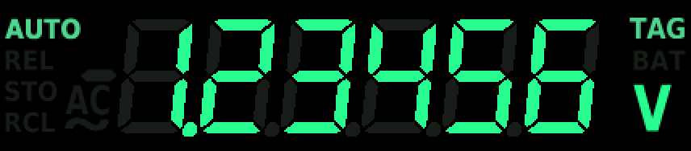

# K197-ESP32S3 — a new display, logger and SCPI interface for the Keithley 197

**English** · [Česky](#česky)

The Keithley 197 is a 5½-digit bench multimeter from the 1980s. Its LCD is the part that ages worst. This
project replaces it with a 428 × 142 px NV3007 TFT driven by an ESP32-S3. The meter itself stays untouched as a
measuring instrument: the ESP32 listens on the DMM's internal bus between its CPU and the original LCD driver
(µPD7225) and decodes every reading (~3.5 per second).

On top of a faithful replica of the original display it adds:

- **Statistics**: average, median, maximum and minimum over 5 s … 6 h, live value, date and time.
- **Graph**: MIN/MAX band and average over 10 s … 24 h or the whole log. Y axis AUTO / ZERO / suppressed zero.
- **Reading log** in PSRAM: about 600 000 readings (~50 h), timestamped by a DS3231 RTC with 10 ms resolution.
- **Limit alarm** per function: lower and/or upper limit, a triangle above the minus sign, an optional beep.
- **Markers (TAG)**: REL + dB together, a foot switch on the rear trigger input, or SCPI. The marked reading is
  easy to find in the log and in the graph.
- **SCPI** over an isolated UART (CH340 on the rear panel) or USB: readings, the log as CSV, statistics, settings,
  diagnostics.
- **Rear-panel trigger I/O**: METERING COMPLETE output and EXTERNAL TRIGGER input (emulated, via optocouplers).
- Context help on the display in Czech and English, 8 colour themes, settings kept in EEPROM.

| | |
|---|---|
|  |  |
|  |  |
|  |  |

> All screenshots are rendered on a PC with the firmware's real drawing code (`tools/make_screenshots.sh`).
> Photos of the instrument are to follow.

### Status

In daily use on one instrument. The firmware is complete and tested on the hardware, and the host tests on a PC
pass. Still being worked on: the power supply for the ESP32 and the display, the rear-panel trigger I/O hardware,
and an SD card slot (planned).

### Documentation

| | |
|---|---|
| [docs/USER_GUIDE.md](docs/USER_GUIDE.md) | front-panel keys, screens, alarm, markers |
| [docs/SCPI.md](docs/SCPI.md) | the SCPI command reference |
| [docs/HARDWARE.md](docs/HARDWARE.md) | parts, pins, wiring, power, safety notes |
| [docs/DEVELOPMENT.md](docs/DEVELOPMENT.md) | architecture, building, host tests, tools, lessons learned |
| [CHANGELOG.md](CHANGELOG.md) | version history |

### Building (short version)

1. Arduino IDE 2.x with the **esp32** core by Espressif. Board: an ESP32-S3 with 8 MB OPI PSRAM and 16 MB flash
   (developed on an ESP32-S3-Nano, module S3R8).
2. Tools menu: **PSRAM: OPI PSRAM**, **Partition scheme: Huge APP**, **USB CDC On Boot: Enabled**.
3. Libraries:
   - Adafruit GFX Library (Library Manager)
   - Vrekrer SCPI parser (Library Manager)
   - Adafruit BusIO (Library Manager, needed by Adafruit GFX)
   - [Adafruit_NV3007](libraries/Adafruit_NV3007) (the NV3007 TFT driver, not an official Adafruit product) and
     [DS3231Centisecond](libraries/DS3231Centisecond), both included in this repository: copy them into your
     Arduino `libraries` folder.
4. Open `firmware/ESP32S3_K197/ESP32S3_K197.ino`. All settings (pins, priorities, themes, timings) are in
   `config.h`. Put your instrument's serial number into `SCPI_IDN_SERIAL`.

Host tests (no Arduino needed, only g++): `cd host_tests && sh run_tests.sh`.

### License and disclaimer

MIT, see [LICENSE](LICENSE). Fonts and other third-party parts keep their own licenses, see
[THIRD_PARTY_LICENSES.md](THIRD_PARTY_LICENSES.md).

This is an independent hobby project. It is **not affiliated with, endorsed by or supported by Keithley
Instruments or Tektronix**. "Keithley" is a trademark of its owner. The firmware answers `*IDN?` with
`KEITHLEY INSTRUMENTS INC.,MODEL 197,…` only so that existing measurement software recognises the instrument.

**Safety:** the K197's logic ground is connected to the measurement input LO. The ESP32, the display and
everything wired to them can therefore be at a dangerous voltage while you measure. Read the safety section of
[docs/HARDWARE.md](docs/HARDWARE.md) before you open or modify the instrument. You do it at your own risk.

---

## Česky

Keithley 197 je stolní multimetr s 5½ místy z 80. let. Nejhůř v něm stárne LCD displej. Tento projekt ho nahrazuje
TFT displejem NV3007 (428 × 142 px), který řídí ESP32-S3. Samotný měřicí přístroj zůstává nedotčený: ESP32
odposlouchává vnitřní sběrnici mezi procesorem multimetru a původním budičem LCD (µPD7225) a dekóduje každé
měření (asi 3,5 za sekundu).

Kromě věrné repliky původního displeje přidává:

- **Statistiku**: průměr, medián, maximum a minimum za 5 s až 6 h, aktuální hodnota, datum a čas.
- **Graf**: pás MIN/MAX a průměr za 10 s až 24 h nebo za celý log. Osa Y AUTO / ZERO / potlačená nula.
- **Log měření** v PSRAM: asi 600 000 odečtů (asi 50 h) s časem z RTC DS3231 v rozlišení 10 ms.
- **Alarm mezí** pro každou funkci zvlášť: dolní a/nebo horní mez, trojúhelník nad znaménkem mínus, volitelně
  pípání.
- **Markery (TAG)**: REL + dB současně, nožní spínač na zadním vstupu triggeru nebo SCPI. Označená hodnota se pak
  snadno najde v logu i v grafu.
- **SCPI** přes galvanicky oddělený UART (CH340 na zadním panelu) nebo USB: měření, log jako CSV, statistika,
  nastavení, diagnostika.
- **Zadní vstupy a výstupy triggeru**: výstup METERING COMPLETE a vstup EXTERNAL TRIGGER (emulované, přes
  optočleny).
- Kontextová nápověda na displeji česky a anglicky, 8 barevných témat, nastavení uložené v EEPROM.

Obrázky obrazovek nahoře jsou vykreslené na PC skutečným kreslicím kódem firmwaru (`tools/make_screenshots.sh`).
Fotky přístroje doplním.

### Stav

Projekt je v každodenním používání na jednom přístroji. Firmware je hotový a odzkoušený na hardwaru, testy na PC
procházejí. Rozpracované zůstává napájení ESP32 a displeje, hardware zadních vstupů a výstupů triggeru a slot pro
SD kartu (v plánu).

### Dokumentace

| | |
|---|---|
| [docs/USER_GUIDE.md](docs/USER_GUIDE.md) | ovládání, obrazovky, alarm, markery |
| [docs/SCPI.md](docs/SCPI.md) | přehled příkazů SCPI |
| [docs/HARDWARE.md](docs/HARDWARE.md) | součástky, piny, zapojení, napájení, bezpečnost |
| [docs/DEVELOPMENT.md](docs/DEVELOPMENT.md) | architektura, překlad, testy na PC, nástroje, poučení |
| [CHANGELOG.md](CHANGELOG.md) | historie verzí |

### Překlad (stručně)

1. Arduino IDE 2.x s jádrem **esp32** od Espressifu. Deska ESP32-S3 s 8 MB OPI PSRAM a 16 MB flash (vyvíjeno na
   ESP32-S3-Nano, modul S3R8).
2. V menu Tools: **PSRAM: OPI PSRAM**, **Partition scheme: Huge APP**, **USB CDC On Boot: Enabled**.
3. Knihovny:
   - Adafruit GFX Library (Library Manager)
   - Vrekrer SCPI parser (Library Manager)
   - Adafruit BusIO (Library Manager, potřebuje ji Adafruit GFX)
   - [Adafruit_NV3007](libraries/Adafruit_NV3007) (ovladač TFT NV3007, není to oficiální produkt Adafruit)
     a [DS3231Centisecond](libraries/DS3231Centisecond), obě přiložené v tomto repozitáři: zkopírujte je do složky
     `libraries` Arduina.
4. Otevřete `firmware/ESP32S3_K197/ESP32S3_K197.ino`. Veškeré nastavení (piny, priority, témata, časy) je
   v `config.h`. Do `SCPI_IDN_SERIAL` zadejte sériové číslo svého přístroje.

Testy na PC (bez Arduina, stačí g++): `cd host_tests && sh run_tests.sh`.

### Licence a upozornění

MIT, viz [LICENSE](LICENSE). Fonty a další převzaté části mají vlastní licence, viz
[THIRD_PARTY_LICENSES.md](THIRD_PARTY_LICENSES.md).

Jde o nezávislý hobby projekt, který **nemá žádný vztah ke společnostem Keithley Instruments ani Tektronix a není
jimi podporován**. „Keithley“ je ochranná známka svého vlastníka. Firmware odpovídá na `*IDN?` řetězcem
`KEITHLEY INSTRUMENTS INC.,MODEL 197,…` jen proto, aby přístroj poznal existující měřicí software.

**Bezpečnost:** logická zem K197 je spojená se vstupem LO. ESP32, displej a vše, co je k nim připojené, proto může
být při měření na nebezpečném napětí. Než přístroj otevřete nebo upravíte, přečtěte si část o bezpečnosti
v [docs/HARDWARE.md](docs/HARDWARE.md). Činíte tak na vlastní odpovědnost.
