# User guide

**English** · [Česky](#návod-k-obsluze)

The front panel has four new keys under the display: **REL**, **dB**, **STO** and **RCL**. The K197's own REL
and dB functions still work: the ESP32 passes a short press on to the meter through optocouplers. The original
rear-panel buttons stay connected in parallel.

A *click* is a press shorter than one second, a *hold* means keeping the key down for about one second
(3 s where noted). Holds act while the key is still down. A short beep confirms the holds that open a settings
screen.

## Screens and keys

### Main display (replica of the K197 LCD)

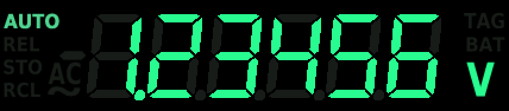

| Key | Click | Hold 1 s |
|---|---|---|
| REL | REL of the K197 (sent at the release) | help for this screen |
| dB | dB of the K197 (sent at the release) | limit alarm settings of the function being measured |
| REL + dB | **marker** (TAG) on the reading shown, nothing is sent to the K197 | — |
| STO | statistics screen | — |
| RCL | graph | DMM settings (language, theme, sound) |

REL and dB reach the K197 only at the release, so that a hold can open the help or the alarm settings instead.
The delay is the length of the press, typically under 0.2 s.

The REM indicator is never lit on this instrument, because there is no GPIB board. Its place shows **TAG**: dim
normally, lit for 2 s after a marker. When the K197 itself lights REM (during its self-test), REM is drawn.

### Statistics (STO)

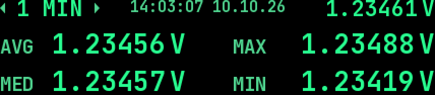

Top line: the interval (between triangles), date and time, live value. Below: **AVG** average, **MED** median,
**MAX** and **MIN** of the readings of the current function within the interval. Intervals: 5 SEC, 10 SEC,
1 MIN, 5 MIN, 15 MIN, 1 HOUR, 6 HRS.

| Key | Action |
|---|---|
| REL / dB | shorter / longer interval (REL and dB do not reach the K197 here) |
| RCL hold 3 s | **clears the whole log** (long confirmation beep) |
| REL hold | help |
| STO | back to the main display |

`--.----` means "no value": the computation is still running after a change, or there is no reading in the
interval yet.

### Graph (RCL)

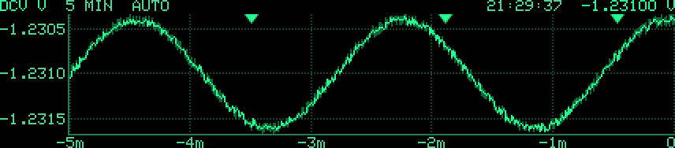

The graph shows the log of the function being measured. A band runs from minimum to maximum and the line is the
average. Each of the 384 pixel columns covers 1/384 of the window. The header shows the function and unit, the
interval, the Y axis mode (with "..." while older records are still being read), the time and the live value.
Markers are small triangles at the top edge. An OL reading is a mark at the top edge.

| Key | Action |
|---|---|
| REL / dB click | shorter / longer interval (at the release) |
| REL + dB | marker on the reading shown |
| RCL click | next Y axis mode: AUTO → ROBUST → ZERO → SUPP → AUTO |
| RCL hold | graph settings |
| REL hold | help |
| STO | back to the main display |

Intervals: 10 SEC, 30 SEC, 1 MIN, 5 MIN, 15 MIN, 1 HOUR, 6 HRS, 24 HRS, FULL (the whole log).
Y axis: **AUTO** = from the lowest to the highest value; **ROBUST** = like AUTO, but the highest 2 % and the
lowest 2 % of the columns do not count for the range, so one short spike does not set the scale (it is clipped and
marked by a dot on the edge; below 20 columns with data it is plain AUTO); **ZERO** = the axis always includes
zero; **SUPP** (suppressed zero) = a fixed centre (the newest value at the moment SUPP is chosen) ± a chosen span,
plus a 10 % reserve on each side. Values outside the axis are clipped and marked by a dot on the edge.

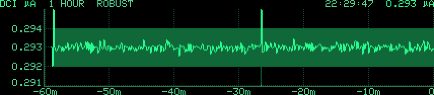

**Graph settings:** INTERVAL, Y AXIS, TRACE (band + average, average only, band only), Y SPAN (the SUPP span,
±1 … ±10000 counts of the last digit).

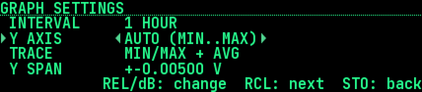

### Settings screens (graph, DMM, alarm)

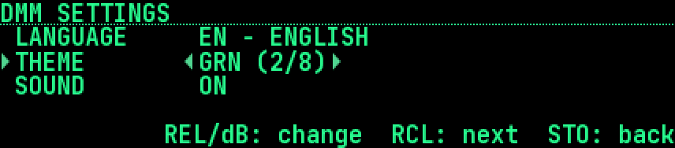

On every settings screen: **RCL** moves to the next line, **REL / dB** change the value on the cursor line, and
**STO** goes back. The screen also closes by itself after 60 s without a key. Changes apply at once. They are
saved to EEPROM about 10 s after the last change, so stepping through values costs a single flash write.

**DMM settings** (RCL held on the main display): LANGUAGE (CZ/EN), THEME (8 colour themes, the display changes at
once), SOUND (all beeps on/off).

#### Colour themes

Each theme sets four colours: background, ghost (unlit segments), indicator and bright (lit digits). The LCD
replica uses them as they are. The text screens (statistics, graph, help, settings) always have a black
background; a theme with a light background (ORG2, LCD1, LCD2) is used there the other way round. Every picture
shows the main display (AUTO and REL lit, alarm on both limits) above the statistics screen. The pictures are
rendered by the firmware's own drawing code (`tools/make_screenshots.sh`).

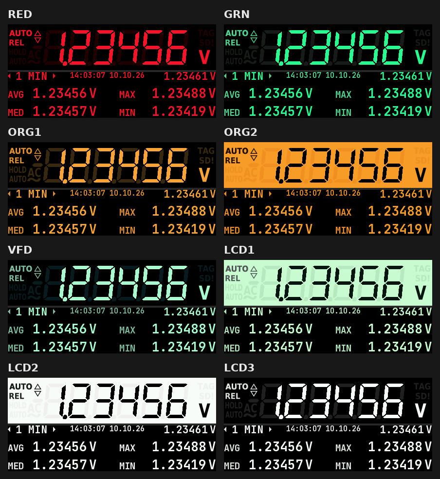

| Theme | Look |
|---|---|
| RED | red LED (the default theme) |
| GRN | green LED |
| ORG1 | orange LED / amber |
| ORG2 | inverted: black digits on an orange background |
| VFD | vacuum fluorescent display, blue-green |
| LCD1 | reflective LCD with a green tint |
| LCD2 | reflective LCD, white |
| LCD3 | white on black |

Single pictures: [RED](images/theme_red.png) · [GRN](images/theme_grn.png) · [ORG1](images/theme_org1.png) ·
[ORG2](images/theme_org2.png) · [VFD](images/theme_vfd.png) · [LCD1](images/theme_lcd1.png) ·
[LCD2](images/theme_lcd2.png) · [LCD3](images/theme_lcd3.png). New themes can be added to `themes[]` in
`config.h`.

### Help

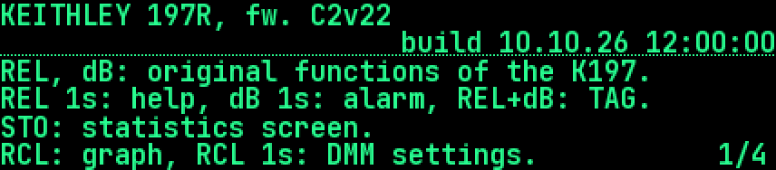

Hold REL on the main display, the statistics, the graph or on the ALARM/SIGNAL lines of the alarm settings to get
the help for that screen. REL / dB click = previous / next page, REL / dB hold = first / last page, STO = back.
The help closes by itself after 60 s without a key.

## Limit alarm

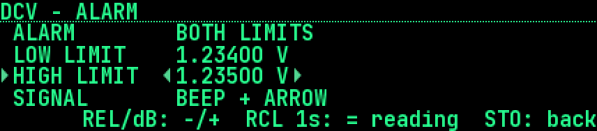

Hold dB on the main display. The alarm settings open for the function being measured (DCV, ACV, DCI, ACI, OHM,
dB); every function has its own limits.

| Line | Values |
|---|---|
| ALARM | OFF, UPPER, LOWER, BOTH LIMITS |
| LOW LIMIT / HIGH LIMIT | the limit in the unit of the display |
| SIGNAL | BEEP + ARROW, ARROW ONLY |

- **Switching a limit on** sets it, if it has no value yet, to the MAX (upper) / MIN (lower) of the last 10 s of
  the log, or to the live reading.
- **On a limit line** REL / dB change the value by one count of the last digit. Held, the value repeats five times
  a second, and the step grows tenfold every 3 s (1, 10, 100 … counts). After the release it starts at one count
  again. **RCL held** on a limit line takes the live reading. RCL click moves to the next line.
- **REL held on the ALARM or SIGNAL line** opens the help. On a limit line a held REL repeats the step instead.
- **Persistence:** the limits and the last mode of every function are kept, but the alarm is **always off after
  power-up**.

The symbol above the minus sign:

| Symbol | Meaning |
|---|---|
|  | outline (two triangles = both limits, one triangle = upper or lower): watched, the reading is inside |
| 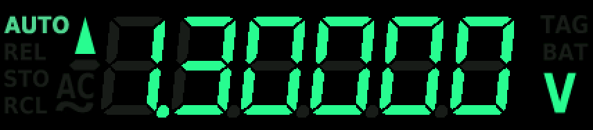 | filled triangle up, blinking: above the upper limit |
|  | filled triangle down, blinking: below the lower limit |

Outside a limit the triangle blinks and, with SIGNAL = BEEP and the sound on, a short beep sounds twice a
second. The reading is compared in counts of the displayed value, so 1.20000 V is not "above" a limit of
1.2 V. OL counts as above, −OL as below. With REL on the K197, the displayed (relative) value is compared.

## Markers

A marker flags the reading that was **on the display at the moment you pressed**, so it can be found again in the
log. The time you need to press the second key does not matter. Ways to set one:

- **REL + dB** together (in any order) on the main display or the graph;
- a press on a switch at the rear **EXTERNAL TRIGGER** input (e.g. a foot switch), after `MEASure:TRIGger MARK`;
- the SCPI command `LOG:MARKer`.

You get a double beep and **TAG** lit for 2 s (on the main display). In the graph a triangle appears at the top
edge. Over SCPI, `LOG:DATA?` shows `TAG` among the indicators of a marked record, and `LOG:MARKer?` lists only the
marked records.

## The log

Every reading goes into the log in PSRAM, about 600 000 readings (~50 h at 3.3 readings/s; then the oldest are
overwritten). Each reading has its date and time from the RTC. The log is **lost when the instrument is switched
off**. Read it out with `LOG:DATA?` before that (an SD card is planned). The log is used by the statistics, the
graph, the alarm defaults and SCPI (`LOG:*`).

**Changing the function.** The statistics and the graph always show only the function being measured (DCV, ACV,
DCI, ACI, OHM, dB). After a switch the graph is rebuilt with the new function: the time spent on the other one
stays a gap, and switching back shows the earlier readings again. A change of range within one function (mV ↔ V)
changes nothing. The first **7 readings (about 2 s) after a change of the function** are still settling, and the
first **20 readings (about 6 s) after the K197 was switched on** (or the ESP32 started). They are logged with the
flag `SETTLE`, but the statistics, the graph and the alarm leave them out (`CONFIG_DATALOG_SETTLE_READINGS`,
`CONFIG_DATALOG_SETTLE_POWERON_READINGS` in `config.h`).

## When the K197 is switched off

If the ESP32 has its own supply (USB, or a battery added later), the log stays while the K197 is switched off.

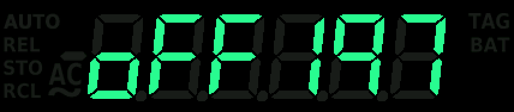

- **4 s** without a usable frame: the main display shows **`oFF197`** when the K197 sends nothing at all (CS quiet,
  the K197 is off), or **`Err197`** when something arrives that cannot be used (a fault). With `oFF197` every
  screen returns to the main display.
- The graph and the statistics keep the last function, so the log can still be looked at (the live value shows
  `--.----`). When the K197 comes back, the gap stays visible in the graph and the older readings stay.
- After **60 s** without a key the ESP32 goes into light sleep. The display keeps its picture (`oFF197`), the log
  stays in PSRAM.
- It wakes up when the K197 is switched on, on any key (that press only wakes it; then all screens work for 60 s)
  and on a start bit on the SCPI UART (the first command is usually lost, send it again). In light sleep the
  native USB (CDC) does not answer.
- `SYSTem:DIAGnostic?` shows the number of light sleeps, the time asleep and the last wake-up cause.
- Settings in `config.h`: `CONFIG_DMM_NO_DATA_MS`, `CONFIG_DMM_OFF_QUIET_MS`, `CONFIG_POWER_*`
  (`CONFIG_POWER_SLEEP_ENABLE 0` = never sleep).

## RTC accuracy

`SYSTem:TIME:AGINg <-128..127>` trims the rate of the DS3231: one step is about 0.1 ppm (about 8.6 ms a day), a
**positive value slows the clock down**. A clock gaining 1 s a day needs about +116 more. The value is applied at
once, kept in the settings and written back into the RTC at boot if the RTC holds another one (e.g. after a
battery change).

---

# Návod k obsluze

Pod displejem jsou čtyři nová tlačítka: **REL**, **dB**, **STO** a **RCL**. Původní funkce REL a dB přístroje K197
fungují dál: krátký stisk předá ESP32 multimetru přes optočleny. Původní tlačítka na zadním panelu zůstávají
zapojená paralelně.

*Klik* je stisk kratší než sekunda, *podržení* znamená držet tlačítko asi sekundu (kde je uvedeno, 3 s). Podržení
se provede ještě během držení. Podržení, která otevírají nastavovací obrazovku, potvrdí krátké
pípnutí.

## Obrazovky a tlačítka

### Hlavní displej (replika LCD K197)

| Tlačítko | Klik | Podržení 1 s |
|---|---|---|
| REL | REL multimetru (odešle se při uvolnění) | nápověda k této obrazovce |
| dB | dB multimetru (odešle se při uvolnění) | nastavení alarmu mezí pro měřenou funkci |
| REL + dB | **marker** (TAG) na zobrazenou hodnotu, do K197 se nic neposílá | — |
| STO | obrazovka statistiky | — |
| RCL | graf | nastavení DMM (jazyk, téma, zvuk) |

REL a dB dostane K197 až při uvolnění, aby podržení mohlo místo toho otevřít nápovědu nebo nastavení alarmu.
Zpoždění odpovídá délce stisku, obvykle pod 0,2 s.

Indikátor REM se na tomto přístroji nikdy nerozsvítí, protože chybí deska GPIB. Na jeho místě je **TAG**:
normálně tlumený, 2 s po markeru rozsvícený. Když REM rozsvítí sám K197 (při self-testu), vykreslí se REM.

### Statistika (STO)

Horní řádek: interval (mezi trojúhelníky), datum a čas, aktuální hodnota. Pod ním: **AVG** průměr, **MED** medián,
**MAX** a **MIN** z odečtů aktuální funkce v intervalu. Intervaly: 5 SEC, 10 SEC, 1 MIN, 5 MIN, 15 MIN, 1 HOUR,
6 HRS.

| Tlačítko | Akce |
|---|---|
| REL / dB | kratší / delší interval (REL a dB se tu do K197 neposílají) |
| RCL podržet 3 s | **smaže celý log** (dlouhé potvrzovací pípnutí) |
| REL podržet | nápověda |
| STO | zpět na hlavní displej |

`--.----` znamená „bez hodnoty“: po změně ještě běží výpočet, nebo v intervalu zatím není žádný odečet.

### Graf (RCL)

Graf zobrazuje log měřené funkce. Pás vede od minima k maximu a čára je průměr. Každý z 384 pixelových sloupců
pokrývá 1/384 okna. V záhlaví je funkce a jednotka, interval, režim osy Y (s „...“, dokud se čtou starší záznamy),
čas a aktuální hodnota. Markery jsou malé trojúhelníky na horní hraně. Odečet OL je značka na horní hraně.

| Tlačítko | Akce |
|---|---|
| REL / dB klik | kratší / delší interval (při uvolnění) |
| REL + dB | marker na zobrazenou hodnotu |
| RCL klik | další režim osy Y: AUTO → ROBUST → ZERO → SUPP → AUTO |
| RCL podržet | nastavení grafu |
| REL podržet | nápověda |
| STO | zpět na hlavní displej |

Intervaly: 10 SEC, 30 SEC, 1 MIN, 5 MIN, 15 MIN, 1 HOUR, 6 HRS, 24 HRS, FULL (celý log).
Osa Y: **AUTO** = od nejnižší po nejvyšší hodnotu; **ROBUST** = jako AUTO, ale 2 % nejvyšších a 2 % nejnižších
sloupců se do rozsahu nepočítá, takže jedna krátká špička nezmění měřítko (ořízne se a na okraji ji označí tečka;
pod 20 sloupci s daty je to obyčejné AUTO); **ZERO** = osa vždy obsahuje nulu; **SUPP** (potlačená nula) = pevný
střed (nejnovější hodnota v okamžiku volby SUPP) ± zvolené rozpětí a 10% rezerva na každé straně. Hodnoty mimo osu
se oříznou a na okraji je označí tečka.

**Nastavení grafu:** INTERVAL, OSA Y, STOPA (pás + průměr, jen průměr, jen pás), ROZPETI Y (rozpětí pro SUPP,
±1 až ±10000 digitů poslední číslice).

### Nastavovací obrazovky (graf, DMM, alarm)

Na každé nastavovací obrazovce **RCL** posune kurzor na další řádek, **REL / dB** mění hodnotu na řádku s kurzorem
a **STO** vrátí zpět. Obrazovka se také sama zavře po 60 s bez stisku. Změny platí hned. Do EEPROM se uloží asi
10 s po poslední změně, takže procházení hodnot stojí jediný zápis do flash.

**Nastavení DMM** (podržení RCL na hlavním displeji): JAZYK (CZ/EN), TEMA (8 barevných témat, displej se změní
hned), ZVUK (všechna pípnutí ZAP/VYP).

#### Barevná témata

Každé téma určuje čtyři barvy: pozadí, ghost (nesvítící segmenty), indikátor a jas (svítící číslice). Replika LCD
je používá přímo. Textové obrazovky (statistika, graf, nápověda, nastavení) mají vždy černé pozadí; téma se
světlým pozadím (ORG2, LCD1, LCD2) se tam použije obráceně. Každý obrázek ukazuje hlavní displej (svítí AUTO a REL,
alarm na obě meze) a pod ním obrazovku statistiky. Obrázky vykreslil přímo kreslicí kód firmwaru
(`tools/make_screenshots.sh`).

| Téma | Vzhled |
|---|---|
| RED | červený LED (výchozí téma) |
| GRN | zelený LED |
| ORG1 | oranžový LED / jantarový |
| ORG2 | inverzní: černé číslice na oranžovém pozadí |
| VFD | vakuový fluorescenční displej, modrozelený |
| LCD1 | reflexní LCD se zeleným nádechem |
| LCD2 | reflexní LCD, bílý |
| LCD3 | bílá na černé |

Jednotlivé obrázky: [RED](images/theme_red.png) · [GRN](images/theme_grn.png) · [ORG1](images/theme_org1.png) ·
[ORG2](images/theme_org2.png) · [VFD](images/theme_vfd.png) · [LCD1](images/theme_lcd1.png) ·
[LCD2](images/theme_lcd2.png) · [LCD3](images/theme_lcd3.png). Další témata lze přidat do `themes[]`
v `config.h`.

### Nápověda

Podržením REL na hlavním displeji, ve statistice, v grafu nebo na řádcích ALARM/SIGNAL nastavení alarmu se otevře
nápověda k dané obrazovce. REL / dB klik = předchozí / další strana, REL / dB podržet = první / poslední strana,
STO = zpět. Nápověda se sama zavře po 60 s bez stisku.

## Alarm mezí

Podržením dB na hlavním displeji se otevře nastavení alarmu pro měřenou funkci (DCV, ACV, DCI, ACI, OHM, dB).
Každá funkce má své vlastní meze.

| Řádek | Hodnoty |
|---|---|
| ALARM | VYP, HORNI, DOLNI, OBE MEZE |
| DOLNI MEZ / HORNI MEZ | mez v jednotce displeje |
| SIGNAL | ZVUK + SIPKA, JEN SIPKA |

- **Zapnutí meze**, která ještě nemá hodnotu, ji nastaví na MAX (horní) / MIN (dolní) z posledních 10 s logu,
  případně na aktuální hodnotu.
- **Na řádku meze** mění REL / dB hodnotu o jeden digit poslední číslice. Při držení se hodnota opakuje pětkrát
  za sekundu a krok se každé 3 s zvětší desetkrát (1, 10, 100 … digitů). Po uvolnění začíná krok znovu od
  jednoho digitu. **Podržení RCL** na řádku meze převezme aktuální hodnotu. Klik RCL přejde na další řádek.
- **Podržení REL na řádku ALARM nebo SIGNAL** otevře nápovědu. Na řádku meze podržení REL místo toho opakuje
  krok.
- **Ukládání:** meze a poslední režim každé funkce se ukládají, ale alarm je **po zapnutí přístroje vždy
  vypnutý**.

Symbol nad znaménkem mínus:

| Symbol | Význam |
|---|---|
| obrys (dva trojúhelníky = obě meze, jeden = horní nebo dolní) | hlídá se, hodnota je v mezích |
| plný trojúhelník nahoru, bliká | nad horní mezí |
| plný trojúhelník dolů, bliká | pod dolní mezí |

Mimo mez trojúhelník bliká a při SIGNAL = ZVUK a zapnutém zvuku dvakrát za sekundu krátce pípne. Hodnota se
porovnává v digitech zobrazené hodnoty, takže 1,20000 V není „nad“ mezí 1,2 V. OL se bere jako nad mezí, −OL jako
pod mezí. Při zapnutém REL na K197 se porovnává zobrazená (relativní) hodnota.

## Markery

Marker označí hodnotu, která byla **na displeji v okamžiku stisku**, aby se dala v logu znovu najít. Na tom, jak
dlouho trvá stisknout druhé tlačítko, nezáleží. Možnosti:

- **REL + dB** současně (v libovolném pořadí) na hlavním displeji nebo v grafu;
- stisk spínače na zadním vstupu **EXTERNAL TRIGGER** (např. nožní spínač) po příkazu `MEASure:TRIGger MARK`;
- příkaz SCPI `LOG:MARKer`.

Následuje dvojpípnutí a na hlavním displeji se na 2 s rozsvítí **TAG**. V grafu se objeví trojúhelník na horní
hraně. Přes SCPI ukazuje `LOG:DATA?` u označeného záznamu mezi indikátory `TAG` a `LOG:MARKer?` vypíše jen
označené záznamy.

## Log

Každý odečet se ukládá do logu v PSRAM, asi 600 000 odečtů (asi 50 h při 3,3 odečtu/s, pak se přepisují
nejstarší). Každý odečet má datum a čas z RTC. Log se **při vypnutí přístroje ztratí**. Před vypnutím ho můžete
vyčíst příkazem `LOG:DATA?` (v plánu je SD karta). Log používá statistika, graf, výchozí meze alarmu a SCPI
(`LOG:*`).

**Změna funkce.** Statistika i graf vždy ukazují jen právě měřenou funkci (DCV, ACV, DCI, ACI, OHM, dB). Po
přepnutí se graf přestaví pro novou funkci: doba měření jiné funkce zůstane jako mezera a po přepnutí zpět jsou
starší odečty znovu vidět. Změna rozsahu v rámci jedné funkce (mV ↔ V) nic nemění. Prvních **7 odečtů (asi 2 s) po změně
funkce** se ještě ustaluje, po **zapnutí K197** (nebo startu ESP32) prvních **20 odečtů (asi 6 s)**. Do logu se
zapíší s příznakem `SETTLE`, ale statistika, graf i alarm je vynechají (`CONFIG_DATALOG_SETTLE_READINGS`,
`CONFIG_DATALOG_SETTLE_POWERON_READINGS` v `config.h`).

## Když je K197 vypnutý

Pokud má ESP32 vlastní napájení (USB, později baterii), log při vypnutí K197 zůstane.

- **4 s** bez použitelného snímku: hlavní displej ukáže **`oFF197`**, když K197 neposílá vůbec nic (CS v klidu,
  K197 je vypnutý), nebo **`Err197`**, když chodí něco nepoužitelného (porucha). Při `oFF197` se každá obrazovka
  vrátí na hlavní displej.
- Graf a statistika drží poslední funkci, takže se v logu dá dál listovat (živá hodnota ukazuje `--.----`). Po
  zapnutí K197 zůstane v grafu vidět mezera a starší odečty zůstanou.
- Po **60 s** bez stisku přejde ESP32 do light sleep. Displej si drží obraz (`oFF197`), log zůstává v PSRAM.
- Probudí ho zapnutí K197, libovolné tlačítko (ten stisk jen probudí, pak 60 s fungují všechny obrazovky) a start
  bit na SCPI UART (první příkaz se obvykle ztratí, pošlete ho znovu). V light sleep neodpovídá nativní USB (CDC).
- `SYSTem:DIAGnostic?` ukazuje počet uspání, celkovou dobu spánku a příčinu posledního probuzení.
- Nastavení v `config.h`: `CONFIG_DMM_NO_DATA_MS`, `CONFIG_DMM_OFF_QUIET_MS`, `CONFIG_POWER_*`
  (`CONFIG_POWER_SLEEP_ENABLE 0` = nikdy nespat).

## Přesnost RTC

`SYSTem:TIME:AGINg <-128..127>` dolaďuje chod DS3231: jeden krok je asi 0,1 ppm (asi 8,6 ms za den), **kladná
hodnota hodiny zpomaluje**. Hodiny, které se předbíhají o 1 s za den, potřebují asi +116 navíc. Hodnota platí
hned, uloží se do nastavení a při startu se zapíše zpět do RTC, pokud v něm je jiná (např. po výměně baterie).
